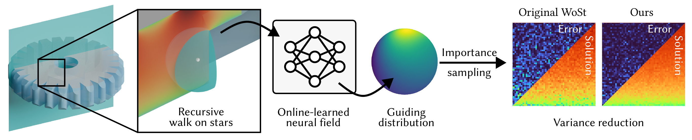
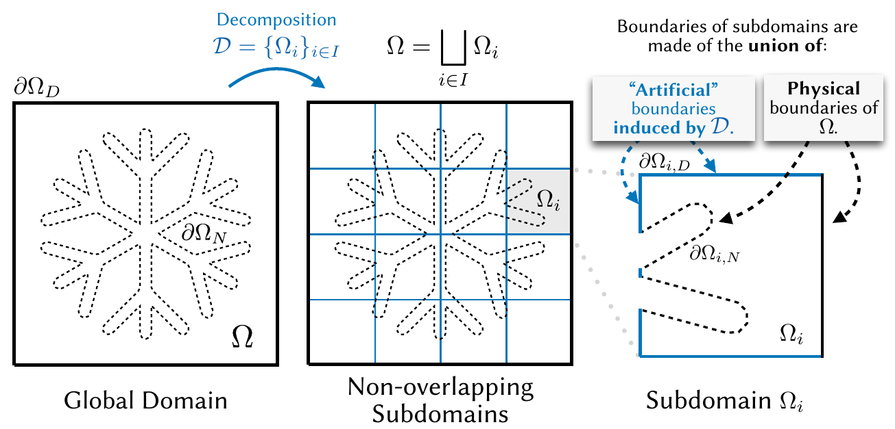
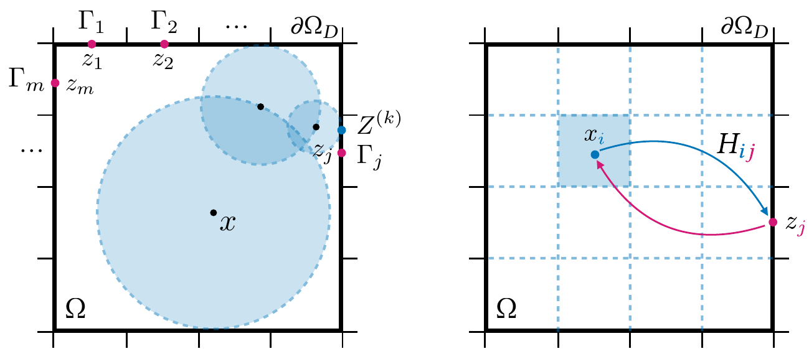
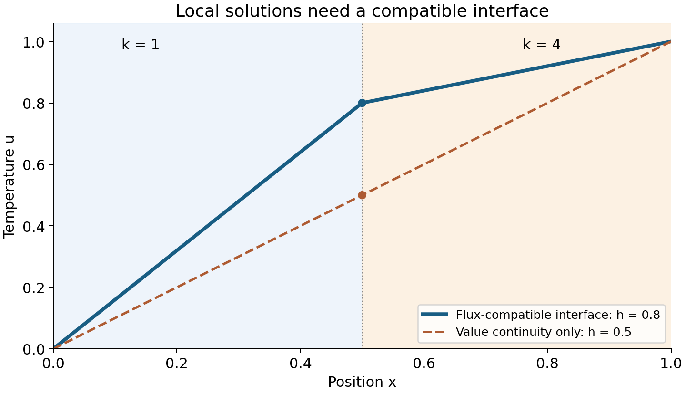
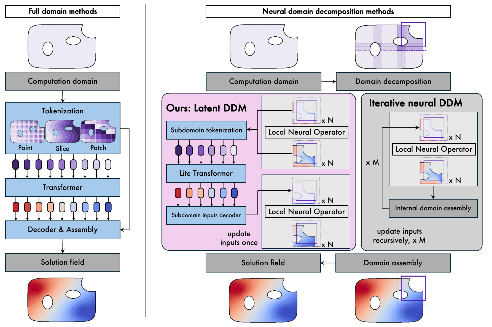
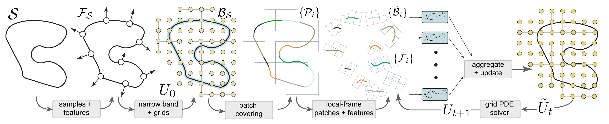
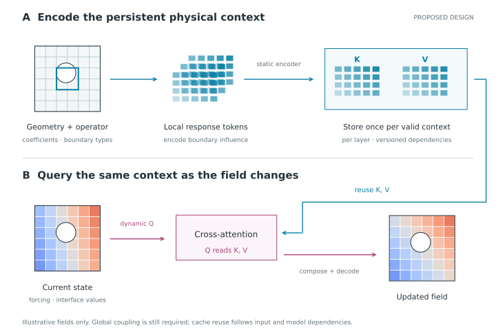
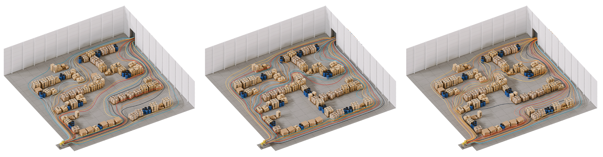

*A developing research note. The papers below establish several useful solver ideas; the cacheable model proposed here remains a research hypothesis.*

Suppose we want to predict temperature in the same building under hundreds of different boundary conditions. The rooms, walls, and material properties stay fixed. The temperatures imposed outside change. Which parts of the computation should we repeat?

That question connects the three topics of this post:

- **Representation:** describe a region by how it responds to its surroundings, so the description can survive a change of boundary values.
- **Model:** determine how those local responses fit together into one physically compatible field.
- **Infrastructure:** store the computations that depend only on persistent context, and reuse them across solves.

Walk-based PDE solvers offer a concrete way to develop this argument. They turn boundary influence into something we can sample, tabulate, and compose. The connection to KV caching comes later: it requires a neural architecture that preserves the same separation between a reusable response and a changing query.

Julia Balla and Hannah Lawrence's [ICLR article on autoregressive tokenization](https://iclr-blogposts.github.io/2026/blog/2026/autoregressive-tokenization/) motivates the representation question. A representation that reconstructs well may still leave difficult predictions for the model. For physical fields, I want to ask the corresponding question: **does the token contain the information needed to compose and reuse a local computation?** Here a token can be a continuous regional descriptor; it need not be a discrete symbol or imply a spatial prediction order. My [reading note](/reads/autoregressive-tokenization/) develops the original tokenization discussion.

## 1. What should a reusable piece of a physical field represent?

### A walk reveals boundary influence

For a harmonic Dirichlet problem on a bounded regular domain,

$$
\Delta u=0\quad\text{in }\Omega,\qquad u=g\quad\text{on }\partial\Omega,
$$

the solution at an interior point can be written

$$
u(x)=\mathbb E_x[g(B_\tau)].
$$

Here \(B_\tau\) is where Brownian motion starting at \(x\) first exits. Geometry determines the exit distribution; boundary values determine what we evaluate at the exit. **For this fixed operator and domain, changing \(g\) changes the answer without changing that distribution.**

Walk on Spheres exploits this representation by jumping between inscribed spheres instead of resolving every small Brownian step. Try the unit-disk example below: the boundary data are \(\cos(2\theta)\), and the exact interior field is \(x^2-y^2\). Its finite stopping tolerance and sampling uncertainty are separate sources of error. This is an original teaching example, not a reproduction of any paper's experiments.



Other PDEs and boundary conditions need their corresponding estimators. In particular, insulating boundaries cannot be handled by simply stopping a Dirichlet walk there.

[Guiding-Based Importance Sampling for Walk on Stars](https://arxiv.org/abs/2410.18944v3) learns where to sample. A neural field predicts directional proposal distributions, with reflection at Neumann boundaries and a learned mixture with uniform sampling. The importance weights preserve the target integral when support and weighting are correct. The learned object is a proposal, not the solution field itself. A guide trained for one boundary-value problem can depend on those values; fixed geometry alone does not establish that the learned guide can be reused.

*Huang, Ling, Zhao, and Xu, [Fig. 1, v3, p.1](https://arxiv.org/pdf/2410.18944v3#page=1). Figure-only excerpt; copyright the authors. Follow the arrows: the network changes the sampling distribution. The displayed comparison is the authors' result, not a result from this blog.*

### From individual walks to a local response operator

[Walk on Decomposed Subdomains (WoDS)](https://clementjambon.github.io/wods/) makes a different reusable object: local first-passage operators. It estimates short walks within subdomains and constructs overlapping co-edge regions to connect their interfaces. The paper's demonstrated setting is two-dimensional harmonic problems with homogeneous Neumann obstacles.

*Jambon, Nabizadeh, and Konaković Luković, [WoDS Fig. 5, p.5](https://clementjambon.github.io/wods/refs/wods.pdf#page=5), [CC BY 4.0](https://creativecommons.org/licenses/by/4.0/). Figure-only crop. The blue cuts create unknown interface values; they are not new prescribed physical boundary conditions.*

The useful representation is a map from boundary values to an interior response. After discretization, write this as \(u_i=H_i g_i\). One row of \(H_i\) records where an interior query exits; multiplying by boundary values gives its answer. This map describes a family of solutions rather than a single field.

*Jambon, Nabizadeh, and Konaković Luković, [WoDS Fig. 8, p.8](https://clementjambon.github.io/wods/refs/wods.pdf#page=8), [CC BY 4.0](https://creativecommons.org/licenses/by/4.0/). Figure-only crop. Read the blue arrow as “where can this query exit?” and the magenta arrow as “how does this boundary input influence the interior?” These are two views of the same matrix entry.*

This gives the tokenization idea a physical meaning. A **field token** summarizes what a region is doing under one condition. A **response token** would summarize what the region can do under a specified family of conditions. The second may be more reusable, but it can require much more storage. Finding a compact, sufficiently accurate response representation is a research problem, not a benefit conferred by calling it a token.

## 2. What must the composition model still solve?

### Local solutions need compatible interfaces

Having a response for each region does not tell us its unknown boundary inputs. Consider our own simple conduction example:

$$
-\frac{d}{dx}\left(k(x)\frac{du}{dx}\right)=0,
\qquad u(0)=0,\quad u(1)=1.
$$

The left half has conductivity 1; the right half has conductivity 4. Their resistances are \(R_L=1/2\) and \(R_R=1/8\). If the shared temperature is \(h\), matching the rightward heat flux requires

$$
\frac{0-h}{R_L}=\frac{h-1}{R_R}.
$$

Hence \(h=0.8\), and both fluxes equal \(-1.6\). Choosing \(h=0.5\) gives two locally valid linear fields that join continuously, but their fluxes are \(-1\) and \(-4\). Continuity alone has left a fictitious interface source or sink.

*Original analytic example. The composition problem is to choose interface data that satisfy the physical coupling conditions. A visually smooth join is insufficient.*

Resistance is enough to describe this interval's endpoint response. To reconstruct an arbitrary interior conductivity profile, we also need the cumulative resistance \(r(x)=\int_a^x k(s)^{-1}ds\):

$$
u(x)=u(a)+[u(b)-u(a)]\frac{r(x)}{R_{[a,b]}}.
$$

So a representation must be sufficient for a declared operation: interface coupling, interior reconstruction, or both.

In WoDS, composition is a deterministic solve for interface values. With transient transition block \(Q\), absorbing block \(R\), and prescribed physical boundary values \(g\),

$$
(I-Q)h=Rg.
$$

Eventual absorption makes this discrete system well posed. Solving it avoids sampling global discrete walks; it does not remove error in the estimated local operators or their discretization. This is an interface-chain construction, not a claim that WoDS uses the flux-matching discretization in our toy example. [WoDS §5.](https://clementjambon.github.io/wods/refs/wods.pdf#page=9)

### Learning can choose the local conditions

Our [Learnable composition for neural operators](https://arxiv.org/abs/2609.03069v1) places learning in this selection step. LatentDDM evaluates a frozen local operator, summarizes the resulting local predictions, and predicts input corrections with a lightweight Transformer. It evaluates the same local operator a second time and assembles the fields.

*Chen, Zhang, and Deng, [Fig. 1, p.4](https://arxiv.org/pdf/2609.03069v1#page=4), [CC BY 4.0](https://creativecommons.org/licenses/by/4.0/). Figure-only crop. In the middle path, predictions become tokens, tokens select corrections, and corrected inputs produce new local fields. Those tokens therefore depend on the current problem instance.*

Two questions remain distinct: can the local operator produce the needed responses, and can the composition model select them? Better selection cannot repair a missing local response family. The paper's coverage/selection analysis formalizes this distinction under its assumptions (§3.2 and Appendix C); its Darcy and airfoil experiments do not establish KV-cache reuse.

A related paper, [Learning to Solve PDEs on Neural Shape Representations](https://arxiv.org/abs/2512.21311v2), makes another choice. Local geometry-conditioned patches learn a normal-constant extension in a narrow Cartesian band; aggregation is followed by a conventional grid PDE update.

*Welschinger, Liu, Wang, and Mitra, [Fig. 2, v2, p.4](https://arxiv.org/pdf/2512.21311v2#page=4). Figure-only excerpt, credited to the authors. Notice the intermediate local coordinate frames and the final grid solver: “mesh-free” does not mean representation-free or discretization-free. Open the figure to inspect its small labels.*

These examples help specify the model's job. Sampling guidance, geometric extension, and global composition learn different objects. A physics foundation model should make those roles explicit.

[Divide-and-Denoise](https://arxiv.org/abs/2606.14756v1) provides a broader connection: it allocates responsibility among diffusion models over latent features as a sample evolves. That motivates learning who contributes where. For a physical field, such allocation must still respect the relevant interface and conservation conditions; the image-generation paper does not provide them.

## 3. Why does this lead to a cacheable model?

The bridge is **separating an operator from its current input**. A local response map can survive a change of boundary values. A neural implementation can reuse its encoded context only if the architecture preserves that separation.

### First make the numerical reuse concrete

Return to the two-material interval. For arbitrary endpoint temperatures \(T_L,T_R\), its shared value is

$$
h=\frac{R_R T_L+R_L T_R}{R_L+R_R}.
$$

The response weights stay fixed while \(T_L,T_R\) change. For \((T_L,T_R)=(0,1)\), \(h=0.8\); for \((1,0)\), \(h=0.2\). We reuse the physical response, then compute a new state.

The same distinction appears in WoDS: with fixed geometry, boundary types, discretization, and estimated operators, the interface matrix can stay fixed while boundary values change the right-hand side. Its factorization can be reused for repeated solves. This is already a strong numerical baseline. Adding a neural cache must improve a relevant workload relative to such reuse, not merely relative to rebuilding everything.

### Then decide what the neural memory contains

A possible response token combines local geometry, coefficients, operator identity, coordinate conventions, and a compressed response description. Call the complete persistent context \(s\). Let \(z^{(m)}\) contain the changing boundary values, forcing, and current interface estimates for solve or update \(m\).

An encoder constructs \(E(s)\). At each decoder layer we can form

$$
\begin{aligned}
K &= E(s)W_K,\\
V &= E(s)W_V,\\
Q^{(m)} &= D(z^{(m)})W_Q,\\
A^{(m)} &= \operatorname{softmax}\!\left(
\frac{Q^{(m)}K^\top}{\sqrt d}\right)V.
\end{aligned}
$$

Here \(d\) is the query/key width. **Keys describe how queries address the persistent context; values carry the features retrieved from it.** The decoder combines that retrieved information with the changing state to predict local conditions or field updates. Layer indices are omitted for readability; each layer has its own projections.

This is an encoder–decoder cross-attention design, a standard distinction reflected in [encoder–decoder model documentation](https://huggingface.co/docs/transformers/model_doc/encoder-decoder). It requires no left-to-right ordering of space. In inference with fixed weights and fixed \(s\), stored K/V give the same cross-attention inputs as recomputing them, up to the chosen numerical precision. The attention weights and output still change with each query.

*Original proposed architecture. Geometry, response arrays, and fields make the represented objects visible. The blue path is reusable context; the lower path changes between solves. The field thumbnails are illustrations, not model predictions.*

A response operator and a KV cache are therefore connected, but they are not identical. The first is a physical map; the second stores intermediate neural features. Softmax attention does not automatically become a Poisson kernel, a flux operator, or a conservative interface solver. A decoder and, potentially, a numerical correction must establish those physical properties. Exact cache reuse can preserve a model's output even when that output is physically inaccurate.

### A repeated-solve workload exposes the design choices

Imagine processing 100 boundary-temperature configurations on one building:

1. **Prepare once.** Encode the fixed geometry and material/operator context; construct the per-layer K/V. A numerical baseline similarly prepares local response maps and reusable factorizations.
2. **Solve each configuration.** Encode its boundary values and changing state, form queries, exchange global/interface information, and decode a field. Recompute all state-dependent operations.
3. **Check compatibility.** Measure boundary errors, flux mismatch, and field error. If the method uses an interface iteration or projection, include it in both correctness and cost.

There is a real representation tradeoff here. Encoding a current predicted field may make composition easier by providing a problem-specific initial answer, as in LatentDDM. Encoding only a reusable response family increases reuse but may leave more inference work to the decoder. **Cacheability should be a co-design objective, not a reason to discard useful state information.** A model may need both static response memory and a fresh dynamic branch.

In particular, freezing LatentDDM's local operator does not freeze its predictions. Change the boundary conditions and its prediction-conditioned tokens change. Reusing their K/V across those problems would generally be wrong. The proposed static branch is an architectural extension to investigate, not an existing feature of our paper.

### Edits determine the lifetime of the cache

*Jambon, Nabizadeh, and Konaković Luković, [WoDS Fig. 3, p.3](https://clementjambon.github.io/wods/refs/wods.pdf#page=3), [CC BY 4.0](https://creativecommons.org/licenses/by/4.0/). Figure-only crop. Local edits change the global paths. This illustrates numerical operator reuse; it is not evidence of neural KV caching.*

Cache validity follows the actual computational dependencies:

| Workload change | Reusable context in the proposed model | Work that must change |
|---|---|---|
| New boundary **values**, same types and operator | Static response encoding and K/V | Queries, interface solution, decoded field |
| New coefficient, boundary **type**, or geometry | Only context independent of the edit | Affected response tokens and K/V, then global coupling |
| New field estimate during an iteration | Static-context K/V | Dynamic queries and any state-to-state attention |
| Updated encoder or K/V projection weights | No reuse of affected learned features | Re-encoding or projections |

Local edits do not necessarily mean local neural invalidation. Independent regional encoders permit local replacement; an encoder that globally mixes all regions can change every token after one edit. A hierarchical design may limit recomputation to a region and its ancestors, but that is a dependency property to verify. Stable region identifiers, coordinate conventions, discretization metadata, and model versions are part of the infrastructure that makes such reuse trustworthy.

For nonlinear or evolving physics, the distinction needs further care. A numerical response linearized around the current state generally changes with that state. A neural geometry-only branch can still be cached, but the dynamic model must account for the state-dependent response. Caching static geometry does not make a nonlinear operator static.

## 4. What would make this useful at foundation-model scale?

The ambition is a reusable physical representation, a model that composes it accurately, and infrastructure that amortizes repeated computation. The first convincing result should be narrower and measurable.

Caching removes repeated context encoding and K/V projection. It does not remove communication: with \(N\) context tokens, \(M\) queries, width \(d\), and \(L\) layers, cache storage scales as \(O(LNd)\), while dense query–context interactions still scale as \(O(LMNd)\) per update. If every region queries every region, the attention work remains quadratic in the number of regions. Elliptic long-range dependence also prevents us from assuming a fixed local neighborhood is sufficient.

This suggests testing local exchanges with a coarse global channel or a numerical interface solve. The representation should support that hierarchy; the infrastructure should batch regional work and retain valid context. Neither a token vocabulary nor a cache by itself supplies global physical consistency.

The economic test is also workload-dependent. Let \(P\) be one-time preparation cost, \(U\) the cost per solve without reuse, and \(C\) the warm cost including cache access. For \(J\) solves, reuse helps when

$$
P+JC\lt JU.
$$

Thus the break-even workload is \(J>P/(U-C)\) when \(U>C\). Frequent invalidation increases preparation cost; cache memory and transfer can increase \(C\). Report both first-solve latency and repeated-solve throughput.

A first experiment can follow the argument directly:

1. **Representation:** compare field tokens and response tokens on fixed-geometry elliptic problems with held-out boundary conditions. Match storage budgets; measure both interface response and interior reconstruction.
2. **Composition:** hold the local response family fixed and compare numerical, iterative, and learned coupling. Measure field error and interface compatibility separately.
3. **Cache correctness and value:** compare the same model with recomputed and cached K/V; then test edits and deliberately stale caches. Report cold/warm latency, memory, invalidation cost, and break-even count against a numerical solver that also reuses its preparation.
4. **Broader transfer:** only after this works, vary geometry, coefficients, physics, and transient histories. Test whether local response knowledge transfers and which components need retraining or rebuilding.

The question I want to pursue is now specific: **can a compact response representation make physical composition accurate and repeated inference cheaper at the same time?** Walk-based solvers clarify the reusable object. Learned composition provides a modeling route. KV-cacheable infrastructure becomes meaningful when the model preserves that object's lifetime across changing physical queries.

## Sources and reading scope

This is a targeted comparison of methods and representations, with original analytic reasoning. It is not an independent benchmark reproduction. Source figures retain their authorship; captions explain the particular feature used in the argument. Click a figure to inspect it at full resolution.

- Huang et al., [Guiding-Based Importance Sampling for Walk on Stars, v3](https://arxiv.org/abs/2410.18944v3), especially §4 and Fig. 1.
- Jambon, Nabizadeh, and Konaković Luković, [Walk on Decomposed Subdomains](https://clementjambon.github.io/wods/refs/wods.pdf), especially §§3–5 and Figs. 3, 5, 8.
- Welschinger et al., [Learning to Solve PDEs on Neural Shape Representations, v2](https://arxiv.org/abs/2512.21311v2), §3 and Fig. 2.
- Chen, Zhang, and Deng, [Learnable composition for neural operators, v1](https://arxiv.org/abs/2609.03069v1), §3, Fig. 1, and Appendix C.
- Gupta et al., [Divide-and-Denoise, v1](https://arxiv.org/abs/2606.14756v1), §3, as a broader composition connection.
- Balla and Lawrence, [Square Peg, Round Hole](https://iclr-blogposts.github.io/2026/blog/2026/autoregressive-tokenization/), ICLR Blogposts 2026.
