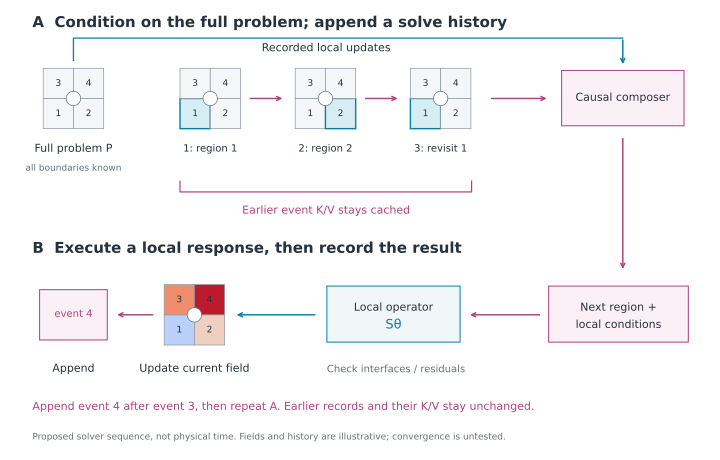

*A developing research note. The papers below establish several useful solver ideas; sequential composition as a next step for LatentDDM remains a research hypothesis.*

Suppose we want to solve a temperature field in a building with many rooms. Could a model construct and refine the solution through a sequence of local computations, using what it has already learned about each room and the updates it has already made? If the boundary conditions change, which parts of that work remain useful?

This is the direction I want to explore beyond our current LatentDDM work. It connects three design choices:

- **Representation:** describe a region by how it responds to its surroundings, so the description can survive a change of boundary values.
- **Model:** learn a sequence of compositions and corrections that fits local responses into one physically compatible field.
- **Infrastructure:** retain valid representations of the solve history and persistent context, so sequential inference can reuse work.

Walk-based PDE solvers offer a concrete way to develop this argument. They turn boundary influence into something we can sample, tabulate, and compose. The connection to KV caching comes from the proposed sequential model: its growing history can support causal-prefix reuse, while a separate physical-context memory may support reuse across problems.

Julia Balla and Hannah Lawrence's [ICLR article on autoregressive tokenization](https://iclr-blogposts.github.io/2026/blog/2026/autoregressive-tokenization/) motivates the representation question. A representation that reconstructs well may still leave difficult predictions for the model. For physical fields, I want to ask the corresponding question: **does the token contain the information needed to compose and reuse a local computation?** Here a token can be a continuous regional descriptor or a local update event. What to tokenize and how to order the computation are joint research choices; a spatial field does not prescribe either choice for us. My [reading note](/reads/autoregressive-tokenization/) develops the original tokenization discussion.

## 1. What should a reusable piece of a physical field represent?

### A walk reveals boundary influence

For a harmonic Dirichlet problem on a bounded regular domain,

$$
\Delta u=0\quad\text{in }\Omega,\qquad u=g\quad\text{on }\partial\Omega,
$$

the solution at an interior point can be written

$$
u(x)=\mathbb E_x[g(B_\tau)].
$$

Here \(B_\tau\) is where Brownian motion starting at \(x\) first exits. Geometry determines the exit distribution; boundary values determine what we evaluate at the exit. **For this fixed operator and domain, changing \(g\) changes the answer without changing that distribution.**

Walk on Spheres exploits this representation by jumping between inscribed spheres instead of resolving every small Brownian step. Try the unit-disk example below: the boundary data are \(\cos(2\theta)\), and the exact interior field is \(x^2-y^2\). Its finite stopping tolerance and sampling uncertainty are separate sources of error. This is an original teaching example, not a reproduction of any paper's experiments.



Other PDEs and boundary conditions need their corresponding estimators. In particular, insulating boundaries cannot be handled by simply stopping a Dirichlet walk there.

[Guiding-Based Importance Sampling for Walk on Stars](https://arxiv.org/abs/2410.18944v3) learns where to sample. A neural field predicts directional proposal distributions, with reflection at Neumann boundaries and a learned mixture with uniform sampling. The importance weights preserve the target integral when support and weighting are correct. The learned object is a proposal, not the solution field itself. A guide trained for one boundary-value problem can depend on those values; fixed geometry alone does not establish that the learned guide can be reused.

*Huang, Ling, Zhao, and Xu, [Fig. 1, v3, p.1](https://arxiv.org/pdf/2410.18944v3#page=1). Figure-only excerpt; copyright the authors. Follow the arrows: the network changes the sampling distribution. The displayed comparison is the authors' result, not a result from this blog.*

### From individual walks to a local response operator

[Walk on Decomposed Subdomains (WoDS)](https://clementjambon.github.io/wods/) makes a different reusable object: local first-passage operators. It estimates short walks within subdomains and constructs overlapping co-edge regions to connect their interfaces. The paper's demonstrated setting is two-dimensional harmonic problems with homogeneous Neumann obstacles.

*Jambon, Nabizadeh, and Konaković Luković, [WoDS Fig. 5, p.5](https://clementjambon.github.io/wods/refs/wods.pdf#page=5), [CC BY 4.0](https://creativecommons.org/licenses/by/4.0/). Figure-only crop. The blue cuts create unknown interface values; they are not new prescribed physical boundary conditions.*

The useful representation is a map from boundary values to an interior response. After discretization, write this as \(u_i=H_i g_i\). One row of \(H_i\) records where an interior query exits; multiplying by boundary values gives its answer. This map describes a family of solutions rather than a single field.

*Jambon, Nabizadeh, and Konaković Luković, [WoDS Fig. 8, p.8](https://clementjambon.github.io/wods/refs/wods.pdf#page=8), [CC BY 4.0](https://creativecommons.org/licenses/by/4.0/). Figure-only crop. Read the blue arrow as “where can this query exit?” and the magenta arrow as “how does this boundary input influence the interior?” These are two views of the same matrix entry.*

This gives the tokenization idea a physical meaning. A **field token** summarizes what a region is doing under one condition. A **response token** would summarize what the region can do under a specified family of conditions. The second may be more reusable, but it can require much more storage. Finding a compact, sufficiently accurate response representation is a research problem, not a benefit conferred by calling it a token.

## 2. What must the composition model still solve?

### Local solutions need compatible interfaces

Having a response for each region does not tell us its unknown boundary inputs. Consider our own simple conduction example:

$$
-\frac{d}{dx}\left(k(x)\frac{du}{dx}\right)=0,
\qquad u(0)=0,\quad u(1)=1.
$$

The left half has conductivity 1; the right half has conductivity 4. Their resistances are \(R_L=1/2\) and \(R_R=1/8\). If the shared temperature is \(h\), matching the rightward heat flux requires

$$
\frac{0-h}{R_L}=\frac{h-1}{R_R}.
$$

Hence \(h=0.8\), and both fluxes equal \(-1.6\). Choosing \(h=0.5\) gives two locally valid linear fields that join continuously, but their fluxes are \(-1\) and \(-4\). Continuity alone has left a fictitious interface source or sink.

*Original analytic example. The composition problem is to choose interface data that satisfy the physical coupling conditions. A visually smooth join is insufficient.*

Resistance is enough to describe this interval's endpoint response. To reconstruct an arbitrary interior conductivity profile, we also need the cumulative resistance \(r(x)=\int_a^x k(s)^{-1}ds\):

$$
u(x)=u(a)+[u(b)-u(a)]\frac{r(x)}{R_{[a,b]}}.
$$

So a representation must be sufficient for a declared operation: interface coupling, interior reconstruction, or both.

In WoDS, composition is a deterministic solve for interface values. With transient transition block \(Q\), absorbing block \(R\), and prescribed physical boundary values \(g\),

$$
(I-Q)h=Rg.
$$

Eventual absorption makes this discrete system well posed. Solving it avoids sampling global discrete walks; it does not remove error in the estimated local operators or their discretization. This is an interface-chain construction, not a claim that WoDS uses the flux-matching discretization in our toy example. [WoDS §5.](https://clementjambon.github.io/wods/refs/wods.pdf#page=9)

### Learning can choose the local conditions

Our [Learnable composition for neural operators](https://arxiv.org/abs/2609.03069v1) places learning in this selection step. LatentDDM evaluates a frozen local operator, summarizes the resulting local predictions, and predicts input corrections with a lightweight Transformer. It evaluates the same local operator a second time and assembles the fields.

*Chen, Zhang, and Deng, [Fig. 1, p.4](https://arxiv.org/pdf/2609.03069v1#page=4), [CC BY 4.0](https://creativecommons.org/licenses/by/4.0/). Figure-only crop. In the middle path, predictions become tokens, tokens select corrections, and corrected inputs produce new local fields. Those tokens therefore depend on the current problem instance.*

Two questions remain distinct: can the local operator produce the needed responses, and can the composition model select them? Better selection cannot repair a missing local response family. The paper's coverage/selection analysis formalizes this distinction under its assumptions (§3.2 and Appendix C); its Darcy and airfoil experiments do not establish KV-cache reuse.

A related paper, [Learning to Solve PDEs on Neural Shape Representations](https://arxiv.org/abs/2512.21311v2), makes another choice. Local geometry-conditioned patches learn a normal-constant extension in a narrow Cartesian band; aggregation is followed by a conventional grid PDE update.

*Welschinger, Liu, Wang, and Mitra, [Fig. 2, v2, p.4](https://arxiv.org/pdf/2512.21311v2#page=4). Figure-only excerpt, credited to the authors. Notice the intermediate local coordinate frames and the final grid solver: “mesh-free” does not mean representation-free or discretization-free. Open the figure to inspect its small labels.*

These examples help specify the model's job. Sampling guidance, geometric extension, and global composition learn different objects. A physics foundation model should make those roles explicit.

[Divide-and-Denoise](https://arxiv.org/abs/2606.14756v1) provides a broader connection: it allocates responsibility among diffusion models over latent features as a sample evolves. That motivates learning who contributes where. For a physical field, such allocation must still respect the relevant interface and conservation conditions; the image-generation paper does not provide them.

## 3. A next step for LatentDDM: model the solve as a sequence

The direction I want to explore is **sequential composition of physical fields**. LatentDDM already separates a local response model from the model that chooses its inputs. A possible next step is to let the composer build and refine a solution through a sequence of local decisions. KV caching would support that model's growing computational history.

This is a proposed research direction. The current LatentDDM paper does not demonstrate an autoregressive composition solver or its cache performance.

### What would the sequence contain?

A PDE field does not come with one obvious token order. We could generate spatial field blocks, advance physical time, or generate successive corrections to an approximate solution. Those choices define different learning problems.

For an initial elliptic study, I would explore **a sequence of local solve/update events**. Each event identifies a region, chooses its local conditions or correction, and records the resulting response. A region may appear more than once. The model predicts the next useful computation; it need not commit every region's final field on its first visit.

Let \(\mathcal P\) denote the full problem specification, including geometry, coefficients, forcing, and physical boundary conditions. Let \(\mathcal H_{m-1}\) be the history of completed update events. One candidate step is

$$
\begin{aligned}
(i_m,c_m)&=C_\phi(\mathcal P,\mathcal H_{m-1}),\\
v_m&=S_\theta(\mathcal P_{i_m},c_m),\\
\mathcal H_m&=\mathcal H_{m-1}\mathbin{\oplus}
(i_m,c_m,\operatorname{summary}(v_m)).
\end{aligned}
$$

Here \(i_m\) selects a region, \(c_m\) supplies its local conditions, and \(S_\theta\) is the local response model. The symbol \(\oplus\) means append a new event. The current full-domain approximation is assembled from the latest regional responses, with a specified rule for overlaps and interfaces. The event history and the current assembled field are different objects; the implementation must keep both consistent.

The index \(m\) counts **solver operations**, not physical time. An unsteady problem could have a physical-time sequence outside this composition loop, but those two axes should be evaluated separately.

This brings Julia Balla and Hannah Lawrence's [tokenization question](https://iclr-blogposts.github.io/2026/blog/2026/autoregressive-tokenization/) directly into the next work: should a token describe a field block, an interface condition, a local response, or an update? And which ordering makes the next conditional prediction learnable? Domain composition supplies candidate units; it does not settle the representation or order.

### Why a causal history can have a KV cache

Suppose the composer encodes its event history with causal attention, conditioned on a fixed \(\mathcal P\). Earlier event representations cannot attend to later events. When a new event arrives, inference can retain the earlier keys and values and append only the new ones:

$$
\begin{aligned}
K_{1:m}&=[K_{1:m-1};k_m],\\
V_{1:m}&=[V_{1:m-1};v_m^{\mathrm{KV}}].
\end{aligned}
$$

The superscript distinguishes the attention value vector \(v_m^{\mathrm{KV}}\) from the local physical response \(v_m\). Every attention layer has its own cache. This is ordinary causal-prefix reuse applied to a proposed sequence of physical computations; the standard mechanism is explained in [Hugging Face's cache documentation](https://huggingface.co/docs/transformers/cache_explanation).

**A later event can correct a region without changing the earlier event's historical meaning.** The record “region 1 was updated at step 3” stays fixed even when region 1 is updated again at step 8. The model needs explicit region/step identities and a way to distinguish the latest state from earlier attempts. Merely concatenating old field values and treating them all as current would be incorrect.

*Original next-work hypothesis. The field can be revised while the event history grows. Causal history K/V is reused within a solve; any separate static-response memory follows its own dependencies. This diagram describes an architecture to test, not a solver result.*

The cache is valid only if earlier token contents, conditioning, positions, masks affecting those tokens, and model weights remain unchanged. Rewriting an earlier event generally requires recomputing its affected suffix. Changing the PDE's boundary values starts a new problem and normally invalidates problem-conditioned history, even if geometry is unchanged. Caching should reproduce the same causal model evaluated without a cache; that equivalence does not establish physical accuracy or convergence.

### Elliptic coupling still requires a global view

A causal model of the *solve* does not make the *physics* spatially one-way. In the two-material example, the interface value depends on both endpoints and both resistances:

$$
h=\frac{R_R T_L+R_L T_R}{R_L+R_R}.
$$

Even an early left-region update needs a route to information about the right boundary. The complete problem can be encoded before the update sequence begins, and the composer can also use a coarse global solution or global residual information. The choice of what enters this context is part of the model design.

A one-pass raster scan may propagate errors or miss long-range compatibility. Repeated regional visits, coarse-to-fine sweeps, or learned region selection are candidate alternatives. They need convergence and cost tests. Attention alone does not guarantee conservation; the solve may need an interface correction, projection, or residual-based stopping rule. Computing that residual also costs work and must be included in timing.

The appeal of composition is that each sequential decision can invoke a substantial local computation. Instead of asking a sequence model to predict every scalar field value directly, we can ask it to choose useful conditions for a reusable local model. Whether this makes sequences shorter and conditionals easier is the hypothesis to test.

### Keep two kinds of neural memory distinct

The static-context idea remains useful, but it is a second memory beside the causal solve history:

| Memory | What it represents | When it can be reused |
|---|---|---|
| Causal history K/V | Earlier update events conditioned on this problem | As the same solve appends events without changing the prefix |
| Static-context K/V | Geometry, operator attributes, or response descriptors encoded independently of changing conditions | Across updates, and possibly across problems whose encoded context is identical |
| Numerical response maps / factors | A discretized physical operator | While the defining operator and discretization remain valid |

For example, changing endpoint temperatures from \((0,1)\) to \((1,0)\) changes \(h\) from 0.8 to 0.2. The resistances remain reusable; the old solve history is not automatically a valid prefix for the new problem. WoDS's fixed interface matrix similarly motivates response and factorization reuse when boundary values change.

*Jambon, Nabizadeh, and Konaković Luković, [WoDS Fig. 3, p.3](https://clementjambon.github.io/wods/refs/wods.pdf#page=3), [CC BY 4.0](https://creativecommons.org/licenses/by/4.0/). Figure-only crop. Local edits can preserve some numerical operators while changing the global solution. Neural cache validity must be checked from the model's own dependencies.*

This also refines the connection to our existing work. Current LatentDDM tokens describe problem-dependent predictions and are composed jointly. They cannot simply be relabeled as a causal cache. A sequential successor could use those predictions as an initial state, learn an update-event representation, and introduce causal composition. It would need new training and rollout evaluation. For nonlinear problems, local responses may also depend on the changing state; a geometry cache does not remove that dependence.

## 4. What should the next work establish?

The ambition is to co-design **representation + sequential composition model + reusable inference infrastructure**. The first study should establish whether this combination solves a useful class of PDE problems accurately, and whether its sequential work is worth the cost.

A focused route from LatentDDM is:

1. **Choose the sequence with the representation.** On a controlled elliptic task, compare field-block tokens with interface/update tokens. Start with a fixed traversal; compare coarse-to-fine or residual-driven scheduling at matched compute. All variants must receive the same available problem information.
2. **Test composition on model-generated histories.** Begin with local-response pretraining, then train the composer on reference-solver trajectories or constructed correction sequences. Different valid update orders need not imply one uniquely correct trajectory. Evaluate free-running solves, repeated regional visits, error accumulation, and stopping behavior; teacher-forced next-step accuracy alone is insufficient.
3. **Isolate the value of sequential modeling.** Compare against current two-pass LatentDDM, iterative numerical/neural coupling, and an appropriate global solver. Match field accuracy and report interface flux mismatch, boundary error, residuals, local-operator calls, and end-to-end latency.
4. **Test the infrastructure separately.** Run the same causal model with and without prefix caching; check agreement, prefix edits, and changed problem conditioning. Ablate static-context reuse separately. Include numerical baselines that reuse response maps or factorizations.

Caching avoids re-encoding a growing prefix, but it does not eliminate attention over that prefix or the sequential critical path. With \(T\) update events, \(N\) static context tokens, width \(d\), and \(L\) layers, a dense cached design uses order \(L(T+N)d\) KV storage. Its attention interactions over the full rollout still cost order \(L(T^2+TN)d\), assuming each event attends to its history and static context. These counts exclude the local PDE models, feed-forward layers, context preparation, and physical checks.

We should therefore measure time to a specified solution error, including preparation and correction. Parallel regional batches, hierarchical summaries, or selective history retrieval may improve scaling, but each changes the dependency structure or model and requires an accuracy check. Reuse across many problems is a separate opportunity from prefix reuse within one solve.

A physics foundation model remains the longer-term goal: transferable local response knowledge and a composition model that can organize computation across geometries, conditions, and tasks. **The next-work hypothesis is that representing a PDE solve as a sequence of physically meaningful compositions makes both the model and its execution more scalable.** Walk-based methods help identify the local objects; LatentDDM supplies the local-model/composer split; causal sequence modeling makes the KV-cache question consequential. The right tokens, order, correction mechanism, and training strategy are still under exploration.

## Sources and reading scope

This is a targeted comparison of methods and representations, with original analytic reasoning. It is not an independent benchmark reproduction. Source figures retain their authorship; captions explain the particular feature used in the argument. Click a figure to inspect it at full resolution.

- Huang et al., [Guiding-Based Importance Sampling for Walk on Stars, v3](https://arxiv.org/abs/2410.18944v3), especially §4 and Fig. 1.
- Jambon, Nabizadeh, and Konaković Luković, [Walk on Decomposed Subdomains](https://clementjambon.github.io/wods/refs/wods.pdf), especially §§3–5 and Figs. 3, 5, 8.
- Welschinger et al., [Learning to Solve PDEs on Neural Shape Representations, v2](https://arxiv.org/abs/2512.21311v2), §3 and Fig. 2.
- Chen, Zhang, and Deng, [Learnable composition for neural operators, v1](https://arxiv.org/abs/2609.03069v1), §3, Fig. 1, and Appendix C.
- Gupta et al., [Divide-and-Denoise, v1](https://arxiv.org/abs/2606.14756v1), §3, as a broader composition connection.
- Balla and Lawrence, [Square Peg, Round Hole](https://iclr-blogposts.github.io/2026/blog/2026/autoregressive-tokenization/), ICLR Blogposts 2026.
