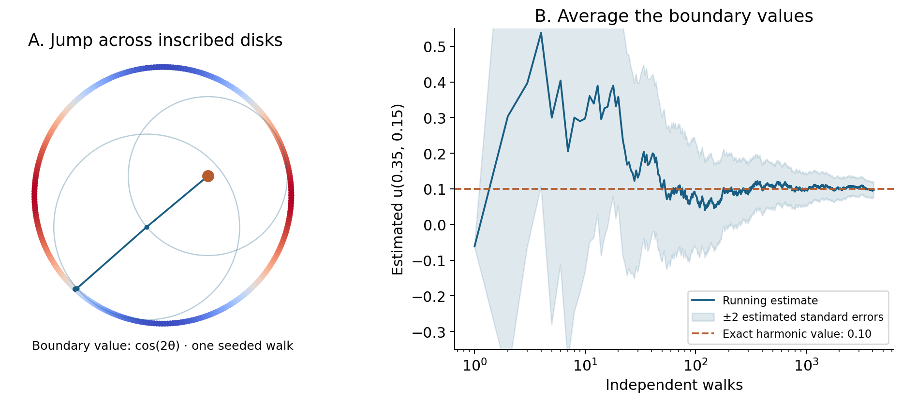
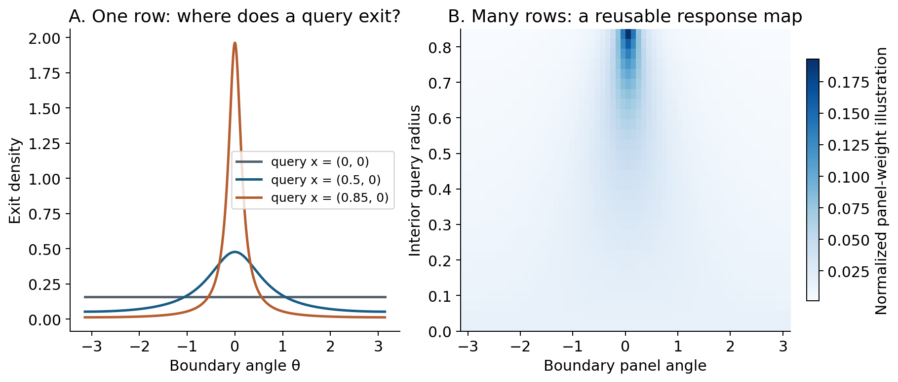
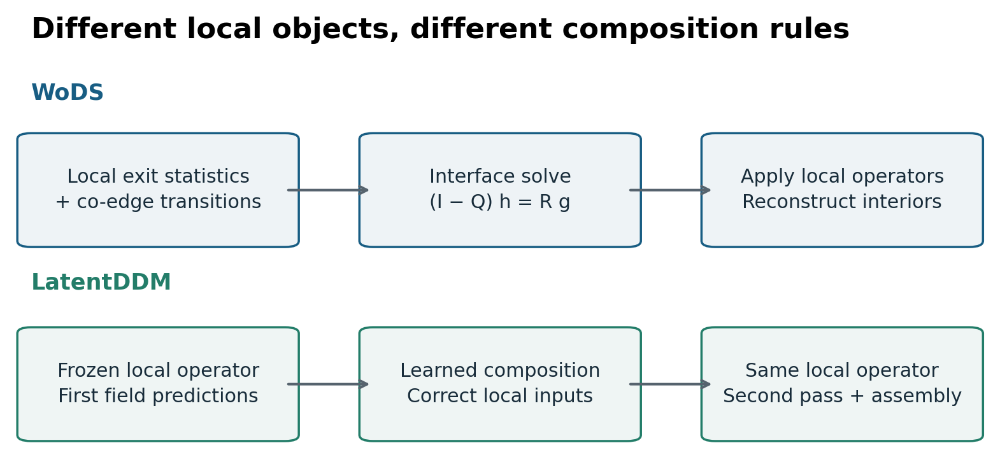
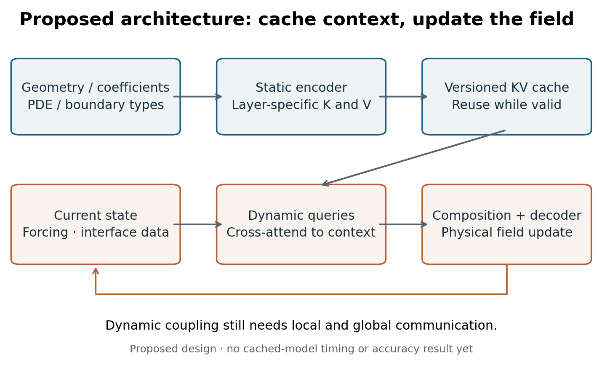
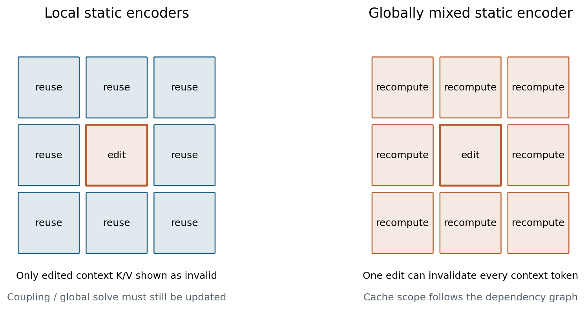

*A developing research note. The solver connections below motivate a proposed architecture; they do not yet establish a physics foundation model.*

Imagine solving a temperature field in a building with many rooms and insulating obstacles. We might construct a mesh, launch random walks from query points, or train a network to predict the field. Each choice also decides what a reusable piece of the calculation looks like.

A mesh stores degrees of freedom and their couplings. A walk samples how a query communicates with the boundary. A local solution operator records how a region responds to different boundary conditions. These are different representations of physical computation, with different opportunities for reuse.

This post asks: **what should a physical representation contain, what model should compose its pieces, and what can the implementation cache?** “Walk on Anything” is the organizing perspective: learn from walk-based solvers how geometry and local responses can become computational building blocks. It is not a claim that one walk algorithm solves every PDE.

## 1. Tokenization is a choice about the work the model must do

Julia Balla and Hannah Lawrence's [ICLR post on autoregressive tokenization](https://iclr-blogposts.github.io/2026/blog/2026/autoregressive-tokenization/) distinguishes changing the prediction order of fixed tokens from changing the representation itself. A compact representation with good reconstruction need not produce easy conditional predictions. Their question is useful beyond discrete autoregression: **does the representation organize information in a way that the chosen model can use?** See also my [reading note](/reads/autoregressive-tokenization/).

For physical fields, I want to investigate domain decomposition through that lens. A region could be represented by sampled values, a compressed field, an interface trace, or a family of responses to exterior influence. Each choice leaves a different problem for the composition model.

Here “token” means a computational unit carrying a specified physical meaning. It may be continuous, variable-sized, and attached to a region. It need not belong to a discrete vocabulary. Nor does selecting tokens require predicting them in a spatial sequence: an elliptic field couples distant regions simultaneously.

## 2. A random walk evaluates a field through its boundary

Start with the Dirichlet problem on a bounded regular domain:

$$
\Delta u=0\quad\text{in }\Omega,\qquad u=g\quad\text{on }\partial\Omega.
$$

For Brownian motion starting at \(x\), with first exit time \(\tau\), the harmonic solution obeys

$$
u(x)=\mathbb E_x[g(B_\tau)].
$$

The probabilistic description replaces a global field query by an average of boundary observations. At the center of a ball contained in the domain, the exit location is uniform on its sphere. Walk on Spheres repeatedly uses this fact to jump across space instead of resolving every small Brownian step. Practical termination near the boundary introduces a tolerance that must be accounted for. This foundation is reviewed in [WoDS, §4.1](https://clementjambon.github.io/wods/refs/wods.pdf).

The expectation formula alone is not a universal solver. Source terms, variable coefficients, surface operators, and different boundary conditions require their corresponding representations and estimators. Insulating boundaries require special care; simply applying a Dirichlet stopping rule there changes the physical problem.

*An analytic check: on the unit disk, boundary data cos(2θ) has solution x² − y². From (0.35, 0.15), 4,096 seeded walks estimate 0.0969 versus the exact 0.1000; the estimated standard error is 0.0110. The shaded band shows sampling uncertainty, not a bound on stopping-shell bias.*



### Learn where to sample

[Guiding-Based Importance Sampling for Walk on Stars](https://arxiv.org/abs/2410.18944v3) learns a position-dependent directional proposal for the recursive estimator. A small neural field produces mixture parameters; reflection handles Neumann boundaries, and a learned mixture with uniform sampling stabilizes the proposal (§4, pp.4–5). The network guides computation rather than directly replacing the field solution. The authors discuss remaining sign variance and singular-data limitations (§7, p.8).

The general importance-sampling identity explains the distinction:

$$
\int F(\omega)\,d\omega
=\mathbb E_{\omega\sim q}\!\left[\frac{F(\omega)}{q(\omega)}\right].
$$

An appropriate proposal changes variance and cost while preserving the integral, provided its support and weights are correct. A learned field surrogate has a different error mechanism. We should keep those roles separate when building a hybrid model.

## 3. Decompose the domain, then solve the communication problem

[Walk on Decomposed Subdomains (WoDS)](https://clementjambon.github.io/wods/) estimates local first-passage operators with short walks. It also constructs overlapping co-edge regions so an original interface can be treated as an interior query. Their transition estimates define an interface chain. With transient block \(Q\), absorbing block \(R\), and physical boundary values \(g\), the global interface values satisfy

$$
(I-Q)h=Rg.
$$

Under eventual absorption from every transient state, this system computes the expected discrete-walk result without sampling those global walks. Local operators then reconstruct interiors. The deterministic solve adds no new sampling variance, but estimated operators and interface discretization still contribute error. The demonstrated setting is two-dimensional harmonic problems with homogeneous Neumann obstacles; broader elliptic and three-dimensional extensions should not be treated as established experiments. [WoDS, §§3–5, especially Eq.(11).](https://clementjambon.github.io/wods/refs/wods.pdf)

The conceptual shift is useful: **a region can be represented by how it transmits boundary influence**. Its unknown interface values still belong to the global problem.

*What a response operator stores. A query near the boundary concentrates its exit distribution nearby; the disk center sees a uniform distribution. The right panel normalizes sampled kernel densities to illustrate a matrix representation; it is not a tabulated WoDS operator.*

## 4. A small example: agreeing on a value is not enough

Consider steady one-dimensional conduction:

$$
-\frac{d}{dx}\left(k(x)\frac{du}{dx}\right)=0,
\qquad u(0)=0,\quad u(1)=1,
$$

with \(k=1\) on the left half and \(k=4\) on the right. This is our own analytic illustration, not a reproduction of any paper's experiment.

For an interval \([a,b]\), define its resistance

$$
\mathcal R_{[a,b]}=\int_a^b\frac{ds}{k(s)}.
$$

Its endpoint values determine the constant rightward flux

$$
q=\frac{u(a)-u(b)}{\mathcal R_{[a,b]}}.
$$

Our two halves have resistances \(1/2\) and \(1/8\). If their shared value is \(h\), conservation requires

$$
\frac{0-h}{1/2}=\frac{h-1}{1/8},
\qquad h=0.8,\qquad q=-1.6.
$$

Assigning \(h=0.5\) instead produces two locally valid linear solutions that meet continuously, yet their fluxes are \(-1\) and \(-4\). The missing interface condition creates a fictitious source or sink.

For this boundary-response task, resistance is a sufficient local descriptor. Reconstructing arbitrary interior profiles additionally requires the cumulative resistance \(r(x)=\int_a^x k(s)^{-1}ds\), since

$$
u(x)=u(a)+[u(b)-u(a)]\frac{r(x)}{\mathcal R_{[a,b]}}.
$$

That distinction matters for tokenization: a representation can be sufficient for interface coupling and insufficient for the requested interior field. Higher-dimensional, transient, or nonlinear physics will generally need richer information. The useful question is sufficient **for which operation and which accuracy?**

## 5. Local models can perform different jobs

[Learning to Solve PDEs on Neural Shape Representations](https://arxiv.org/abs/2512.21311v2) learns a geometry-conditioned update in a narrow Cartesian band around a surface. Local patches support a learned normal-constant extension, followed by aggregation and a conventional grid PDE step (§3). It avoids extracting a surface mesh; it does not eliminate discretization. Grid spacing, band thickness, and unreliable geometry near the medial axis remain limitations (p.8).

Together these methods suggest several places for learning: a sampling proposal, a geometric extension, or a local response. These are not interchangeable targets. We should name the learned object before comparing models.

Our [Learnable composition for neural operators](https://arxiv.org/abs/2609.03069v1) supplies another division of labor. LatentDDM first applies a pretrained local operator, summarizes local predictions into subdomain tokens, and uses a lightweight Transformer to predict input corrections. A second evaluation of the same frozen local operator produces the fields to assemble. Target adaptation updates the composition module (§3.1).

The important distinction is between **the responses the local model can represent** and **the response the composition model selects**. With the paper's notation,

$$
\begin{aligned}
\widehat u&=F_X(c_\phi(X)),\\
\|\widehat u-u_X^*\|
&\leq \epsilon_{\mathrm{loc}}(X)
+L_X\|c_\phi(X)-c_X^\dagger\|.
\end{aligned}
$$

assuming the response map is \(L_X\)-Lipschitz and a best condition exists. The local coverage term cannot be removed just by improving selection. A numerical search for a good condition gives a diagnostic, not a certificate of the global optimum. [§3.2 and Appendix C.](https://arxiv.org/abs/2609.03069v1)

This makes representation and composition joint design choices. The paper's Darcy and airfoil studies motivate the program; they do not establish arbitrary-physics transfer or KV-cache performance.

*An original schematic comparing the roles of local computation and global composition. It does not imply that the two methods solve identical tasks.*

### Composition beyond PDE solvers

[Divide-and-Denoise](https://arxiv.org/abs/2606.14756v1) coordinates pretrained diffusion models by allocating responsibility over latent features, then aligning denoising with that allocation. Its allocation evolves with the sample (§3). I include it as a composition connection: deciding which model should act where can itself be part of inference. Its image-generation results and fairness constraints do not supply conservation or interface conditions for a physical field.

## 6. Outlook: representation + model + cacheable infrastructure

The longer-term aim is a physics foundation model whose reusable units support multiple geometries, conditions, and tasks. Scaling the network is one part of this. We also need an infrastructure that can reuse physical context and local computation across queries and solves.

My working hypothesis is:

> A useful physical token describes a local response family and its interface; a composition model supplies the changing context; the implementation reuses the parts that remain valid.

This is an architectural proposal inspired by the papers, not an implementation or result reported by them.

### Represent persistent context separately from changing state

For region \(i\), distinguish:

- Persistent context \(s_i\): geometry, coefficients, operator identity, and boundary types.
- Changing state \(z_i^{(t)}\): field values, interface data, and current forcing.

The label “persistent” is relative to a workload. Coefficients may change during optimization; geometry may move; boundary values may change between queries. Each change has to be reflected in cache validity. Initial conditions and history belong in the representation whenever the target response depends on them.

A candidate encoder would build tokens from \(s_i\), perhaps including a compressed local response operator. A dynamic decoder would use \(z_i^{(t)}\) and exchanged interface information to select or update the field. A response token is only useful if it preserves the information needed for the downstream physics; compressing it into a vector does not establish that property.

### Make the neural architecture explicitly KV-cacheable

One possible design uses a static-context encoder and a dynamic cross-attention decoder. For a decoder layer \(\ell\), write

$$
\begin{aligned}
K_i^{(\ell)}&=W_K^{(\ell)}E_i(s),\\
V_i^{(\ell)}&=W_V^{(\ell)}E_i(s),\\
Q_i^{(\ell,t)}&=W_Q^{(\ell)}D_i^{(\ell,t)}.
\end{aligned}
$$

where \(E_i(s)\) depends only on persistent context and frozen encoder parameters. The keys and values can then be reused while dynamic queries change. The encoder may use all static regions; if so, a local geometry edit can invalidate more than one encoded token.

This resembles encoder–decoder KV reuse. It is different from assuming an autoregressive language model's cache applies unchanged to a physical solver. Physical-time history can also be cached with an appropriate causal architecture, but a simultaneous elliptic solve has no privileged spatial left-to-right order.

If a layer jointly mixes geometry with changing field states, its hidden representations change too; its old keys and values are generally stale. Simply freezing network weights is not enough. LatentDDM's prediction-conditioned tokens would need a dependency audit or architectural separation before reuse could be claimed.

*The proposed cache boundary is an architectural choice. Geometry context stays fixed within a workload; changing field information follows the lower path.*

### Distinguish three kinds of reuse

| Reusable object | What it saves | Validity condition |
|---|---|---|
| Geometry data, neighborhoods, local charts | Geometric preprocessing | Geometry, sampling, and chart conventions unchanged |
| Local response operators or a global factorization | Repeated physical solution work | The defining operator and discretization unchanged; new right-hand sides handled consistently |
| Neural keys and values for static context | Repeated context encoding and K/V projection | Encoder inputs, model weights, positions, masks, precision and configuration unchanged |

These caches complement each other. Numerical operator reuse is not itself a Transformer KV cache, and cached neural context is not a cached PDE solution.

A cacheable implementation needs stable region identifiers, explicit physical units and coordinate maps, operator/version metadata, and a dependency graph for invalidation. It should support different token counts and resolutions without confusing padding with physical boundary data. An updated region may require recomputing neighboring couplings or coarse global summaries. Even when only a few local operators change, the resulting field can change throughout the domain.

*Cache validity follows dependencies. The left panel concerns independent context encoders only; physical coupling and a global solution still need updating.*

### A cache does not remove the global communication problem

With \(N\) context tokens, \(M\) queries, width \(d\), and \(L\) layers, stored keys and values require order \(LNd\) memory. Dense query–context interactions still cost order \(LMNd\) per update, even if context projections are reused. Setting \(M=N\) leaves quadratic attention.

A scalable physical model may therefore need local exchanges plus a coarse global channel, a hierarchy, or a numerical interface solve. For elliptic physics, restricting communication to a fixed local neighborhood can miss long-range dependence. Compression, communication, and caching must be evaluated together.

The infrastructure question is concrete: **which computations can be amortized over a workload without losing the physical response we need?** Workloads might include many boundary conditions on one geometry, repeated inverse-design queries, or long trajectories with mostly static geometry. A moving-geometry workload offers different reuse opportunities.

## 7. What would make this direction convincing?

The first experiments should separate representation quality, composition quality, and implementation savings.

1. **Representation.** On an analytically checkable elliptic problem, compare value tokens, interface traces, and compressed response operators at matched storage and reconstruction accuracy. Test new boundary conditions, not just a single field.
2. **Composition.** Freeze the local model and compare a numerical interface reference, iterative coupling, and learned composition. Measure field error, interface flux mismatch and residuals. Include a post-hoc oracle-condition diagnostic to distinguish local coverage from selection error.
3. **Caching correctness.** Implement a static-context cross-attention reference with cached and recomputed K/V. Verify numerical agreement within the declared precision. Test invalidation after a boundary-type change, coefficient edit, geometry edit, and weight update; deliberately stale caches are a failure control.
4. **Scaling.** Report cold-start time, warm repeated-query time, memory, cache hit rate and amortization break-even point, including preprocessing and invalidation. Sweep domain size and edit frequency. A warm-cache speedup alone does not establish faster first solves or lower total training cost.

The first research decision is whether a reusable local response representation retains accuracy under changing exterior conditions while reducing the work needed for repeated inference. If it does, the next step is a hierarchy of such responses with a physically adequate communication model. That would give the physics-foundation-model ambition a measurable foundation: a representation, a model, and infrastructure that scale together.

## Reading trail

This draft uses targeted comparison reading, not a full experimental replication. Coverage centers on the methods, composition equations, and limitations cited above. Full benchmark tables and implementation equivalence remain to be audited.

- Huang et al., [Guiding-Based Importance Sampling for Walk on Stars, v3](https://arxiv.org/abs/2410.18944v3).
- Jambon, Nabizadeh, and Konaković Luković, [Walk on Decomposed Subdomains](https://clementjambon.github.io/wods/refs/wods.pdf), ACM TOG 2026.
- Welschinger et al., [Learning to Solve PDEs on Neural Shape Representations, v2](https://arxiv.org/abs/2512.21311v2).
- Gupta et al., [Divide-and-Denoise, v1](https://arxiv.org/abs/2606.14756v1).
- Chen, Zhang, and Deng, [Learnable composition for neural operators, v1](https://arxiv.org/abs/2609.03069v1).
- Balla and Lawrence, [Square Peg, Round Hole](https://iclr-blogposts.github.io/2026/blog/2026/autoregressive-tokenization/), ICLR Blogposts 2026.
